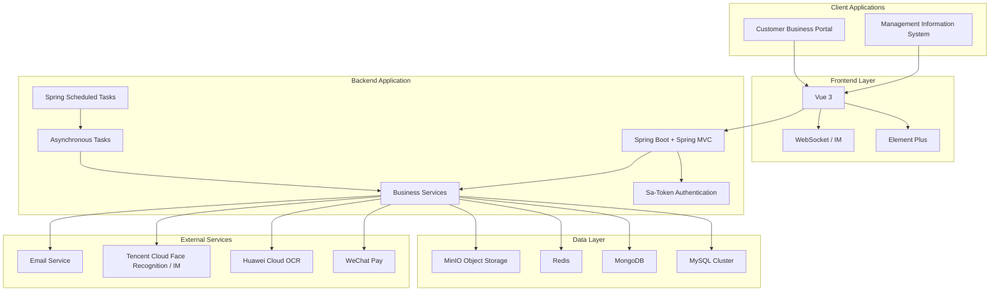
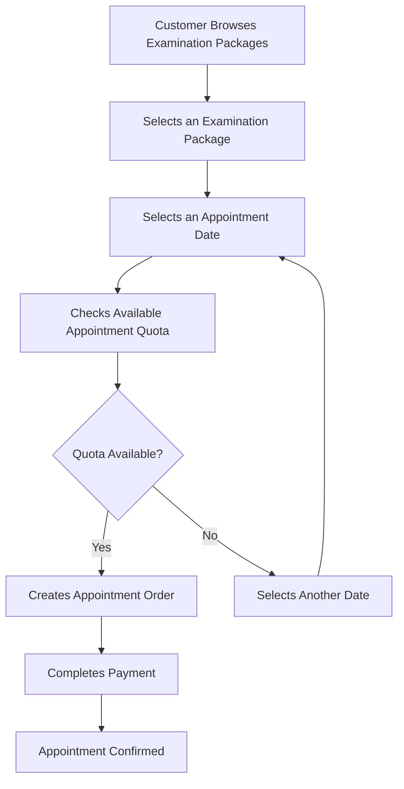
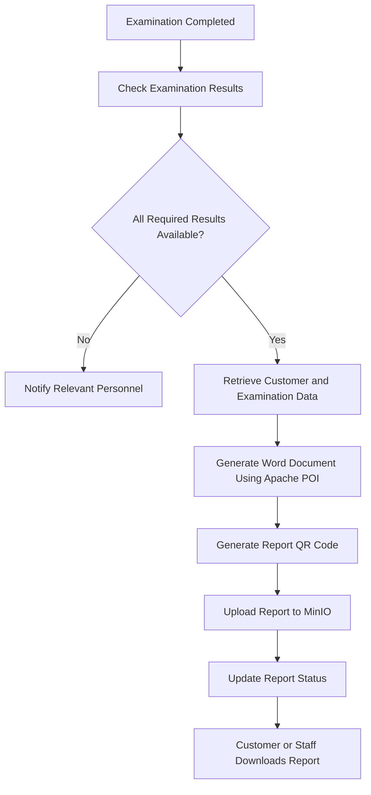
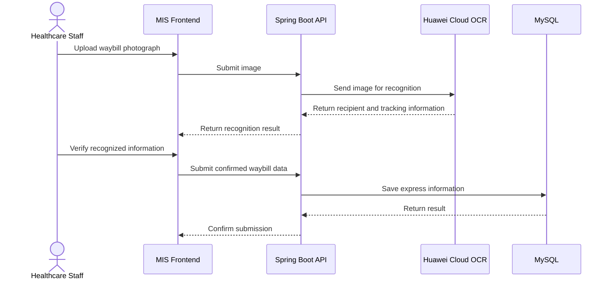

# HIS Healthcare Management System

<p align="center">
  <strong>A Full-Stack Healthcare Examination Management System</strong>
</p>

<p align="center">
  An integrated healthcare platform for examination appointments, order and payment management, medical report generation, and healthcare center operations.
</p>

---

## Overview

The **HIS Healthcare Management System** is a healthcare examination management platform developed for Tianjin Meinian Onehealth Healthcare Center.

The system connects customers, healthcare center staff, and medical professionals through two main applications:

- **Business Portal:** Allows customers to browse and purchase examination packages, schedule appointments, manage orders, and access their medical examination reports.
- **Management Information System (MIS):** Allows healthcare center staff to manage business operations, handle customer check-ins, print examination guidance sheets, manage examination reports, and maintain operational data.

The platform integrates payment services, object storage, OCR recognition, face recognition, instant messaging, and automated report generation to improve the efficiency of healthcare examination operations.

## Key Features

### Customer Services

- Browse and purchase medical examination packages.
- Schedule examination appointments.
- Manage examination orders.
- Complete online payments and request refunds.
- View and download generated examination reports.
- Access appointment and examination information.

### Healthcare Center Management

- Manage customer and appointment information.
- Manage examination packages and business data.
- Handle customer check-in procedures.
- Print examination guidance sheets.
- Manage examination results.
- Generate and download medical examination reports.
- Manage report delivery information.
- Import express delivery records from Excel files.

### Medical Examination Reports

- Automatically generate Word-format examination reports.
- Generate reports in batches through scheduled tasks.
- Support manual report generation.
- Generate QR codes for report identification.
- Store generated documents in MinIO.
- Download reports through permission-controlled APIs.
- Support multiple report templates, including templates with medical images.

### Express Delivery Management

- Upload express waybill photographs.
- Automatically recognize recipient names, phone numbers, and tracking numbers using Huawei Cloud OCR.
- Verify recognized information before submission.
- Save express tracking numbers and delivery dates.
- Import waybill information in batches through Excel.

### Security and Access Control

- Token-based authentication using Sa-Token.
- Role-based and permission-based access control.
- Backend request validation.
- XSS protection.
- Unified exception handling.
- Centralized API response formatting.

## System Architecture

The system follows a front-end and back-end separated architecture.



*Note: This diagram illustrates the main logical components and integrations described in the project documentation. It is not intended to represent every deployment node or service connection.*

## Technology Stack

### Backend

| Technology | Purpose |
|---|---|
| Java 21 | Development platform |
| Spring Boot | Backend application framework |
| Spring MVC | RESTful API development |
| Spring Cache | Application caching |
| MyBatis | Database access and SQL mapping |
| Sa-Token | Authentication and authorization |
| Hibernate Validator | Request parameter validation |
| Lombok | Reduce boilerplate code |
| Hutool | General-purpose Java utilities |
| QLExpress | Dynamic business rule execution |
| Apache POI | Excel processing and Word report generation |
| ZXing | QR code generation |
| WebSocket | Real-time communication |
| Spring Scheduling | Scheduled tasks |
| JavaMail | Email delivery |

### Frontend

| Technology | Purpose |
|---|---|
| Vue 3 | Frontend framework |
| Element Plus | UI component library |
| TypeScript | Type-safe frontend development |
| Axios | HTTP communication |
| Less | CSS preprocessing |
| WebSocket / IM | Real-time messaging |

### Data Storage and Infrastructure

| Technology | Purpose |
|---|---|
| MySQL | Core relational business data |
| ShardingSphere | Database cluster management and read/write splitting |
| MongoDB | Document-oriented and flexible JSON data |
| Redis | Caching and appointment quota control |
| MinIO | Medical report and file storage |

### Third-Party Integrations

| Service | Purpose |
|---|---|
| WeChat Pay API v3 | Payment and refund processing |
| Huawei Cloud OCR | Express waybill recognition |
| Tencent Cloud Face Recognition | Face recognition |
| Tencent Cloud IM | Instant messaging |

## Core Business Workflows

### 1. Examination Appointment



The system uses Redis transactions and optimistic locking to control appointment quotas and reduce the risk of overselling.

### 2. Payment and Refund Processing

The payment module integrates WeChat Pay API v3.

Key mechanisms include:

- Online payment processing.
- Refund processing.
- Active payment and refund status queries.
- Scheduled reconciliation of payment and refund results.
- Automatic closure of overdue unpaid orders.

These mechanisms help prevent inconsistent order states when payment notifications are missed or delayed.

### 3. Medical Report Generation



Report generation supports both scheduled batch processing and manual generation.

The report document can include:

- Customer information.
- Examination package information.
- Examination department details.
- Examination results.
- Reference values and units.
- Medical images.
- Doctor signatures and examination dates.

### 4. Express Waybill Recognition



The OCR workflow extracts the recipient name, recipient phone number, and express tracking number. Staff members can verify the recognized information before saving it.

## Engineering Highlights

### 1. Database Cluster Management

The project documentation describes a seven-node MySQL cluster managed through ShardingSphere.

The architecture uses read/write separation to improve database I/O performance and database availability.

### 2. Redis-Based Appointment Quota Control

Appointment capacity must be controlled under concurrent requests.

The system uses:

- Redis transactions.
- Optimistic locking.
- Cached appointment quota information.
- Scheduled initialization of future appointment quota data.

These mechanisms help prevent appointment overselling.

### 3. MySQL and MongoDB Hybrid Storage

The system uses different storage technologies for different data requirements.

- **MySQL:** Structured business data and transactional records.
- **MongoDB:** Flexible document data, product snapshots, and complex JSON query scenarios.

### 4. Automated Scheduled Tasks

Spring's scheduling capabilities are used for recurring business operations.

Examples include:

- Initializing appointment quota caches.
- Updating recommended examination departments.
- Generating examination reports in batches.
- Closing overdue unpaid orders.
- Checking payment and refund statuses.

### 5. Asynchronous Processing

Spring asynchronous tasks are used to prevent time-consuming operations from blocking the main application flow.

Typical use cases include:

- Batch examination report generation.
- Appointment quota cache initialization.
- Recommended department data initialization.

### 6. Dynamic Business Rules

QLExpress is used to execute configurable business rules.

Promotion rules can be stored and maintained in the database instead of being hardcoded into application logic. This allows business rules to be updated without rebuilding and redeploying the application.

### 7. Unified Security and Exception Handling

The backend provides:

- Sa-Token authentication and permission checks.
- Request parameter validation.
- XSS protection.
- Cross-origin configuration.
- Global exception handling.
- Unified API response objects.
- Reusable pagination objects.

## Main Functional Modules

| Module | Description |
|---|---|
| Customer Management | Customer information and related records |
| Examination Package Management | Package browsing and management |
| Appointment Management | Appointment scheduling and quota control |
| Order Management | Order lifecycle and status management |
| Payment Management | WeChat payment and refund processing |
| Check-in Management | Customer check-in operations |
| Examination Guidance | Guidance sheet printing |
| Examination Results | Examination result management |
| Report Management | Report generation, download, and status management |
| Express Management | Waybill recognition and delivery information |
| Permission Management | User authentication and access control |
| Promotion Rules | Dynamic promotion rule configuration |
| Messaging | Instant messaging and notifications |

## Development Environment

The development environment described in the project documentation includes:

- JDK 21
- IntelliJ IDEA
- MySQL
- Redis
- MinIO
- Visual Studio Code

The project also requires the corresponding external service credentials when using integrated services such as WeChat Pay, Huawei Cloud OCR, and Tencent Cloud services.

## Configuration

Sensitive credentials should be provided through environment variables rather than committed to the repository.

For example, Huawei Cloud OCR configuration:

```yaml
huawei:
  appKey: ${HUAWEI_OCR_APPKEY}
  appSecret: ${HUAWEI_OCR_APPSECRET}
```

Do not commit actual API keys, passwords, private keys, or payment certificates to GitHub.

## Getting Started

The project documentation identifies the development environment and external dependencies, but does not provide a complete, verified set of repository-wide startup commands.

Before publishing this repository, add the following project-specific information:

1. Clone the repository.
2. Configure the JDK and Maven environment.
3. Prepare MySQL, Redis, MongoDB, and MinIO.
4. Import the database initialization scripts.
5. Configure `application.yml` and external service credentials.
6. Start the Spring Boot backend.
7. Install frontend dependencies.
8. Configure the frontend API base URL.
9. Start the Vue frontend applications.

> The exact Maven commands, frontend scripts, database initialization files, and application ports should be filled in according to the actual repository.

## Project Structure

The complete source directory tree is not included in the available project documentation. The following is a suggested structure for organizing the repository:

```text
his-healthcare-system/
├── backend/
│   ├── src/
│   └── pom.xml
├── frontend/
│   ├── business-portal/
│   └── mis-portal/
├── database/
│   └── sql/
├── docs/
│   ├── architecture.md
│   ├── database-design.md
│   ├── business-workflows.md
│   └── deployment.md
└── README.md
```

This is a documentation suggestion, not a verified copy of the original repository structure.

## Future Improvements

Potential areas for further development include:

- Add Docker Compose deployment configurations.
- Improve automated testing and integration testing.
- Add API documentation and examples.
- Improve monitoring and logging.
- Strengthen sensitive medical data protection.
- Add more detailed system architecture and sequence diagrams.
- Improve report generation performance and failure recovery.
- Add CI/CD automation.

## Security Notice

This project handles sensitive healthcare and personal information.

When deploying or maintaining the system:

- Never expose patient information in public repositories.
- Never commit production credentials.
- Restrict access to medical reports and examination records.
- Protect uploaded documents and images.
- Apply appropriate data access controls and audit logging.

## License

No license information was specified in the provided project documentation.

Add an appropriate open-source license before publishing this repository publicly.

## Acknowledgements

This project integrates multiple open-source frameworks and third-party services, including Spring Boot, MyBatis, Vue, Element Plus, Redis, MongoDB, MinIO, Apache POI, WeChat Pay, Huawei Cloud, and Tencent Cloud.

